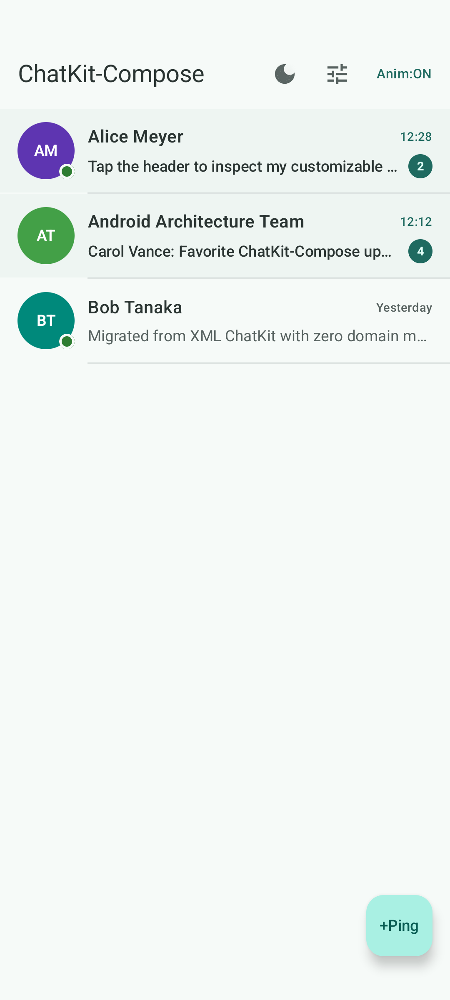
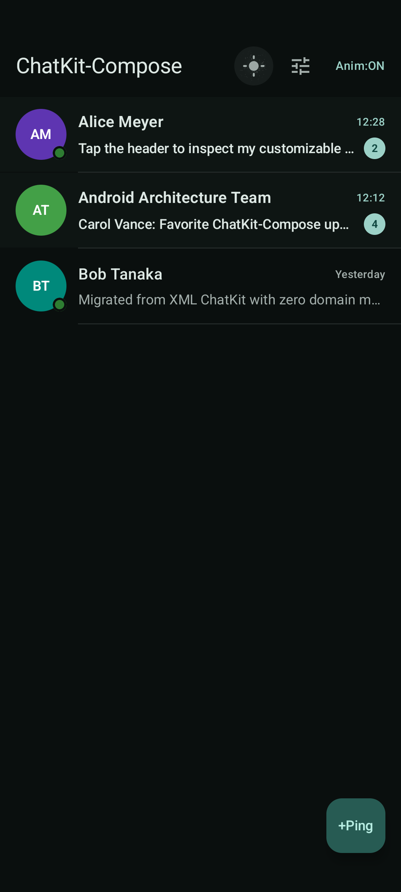
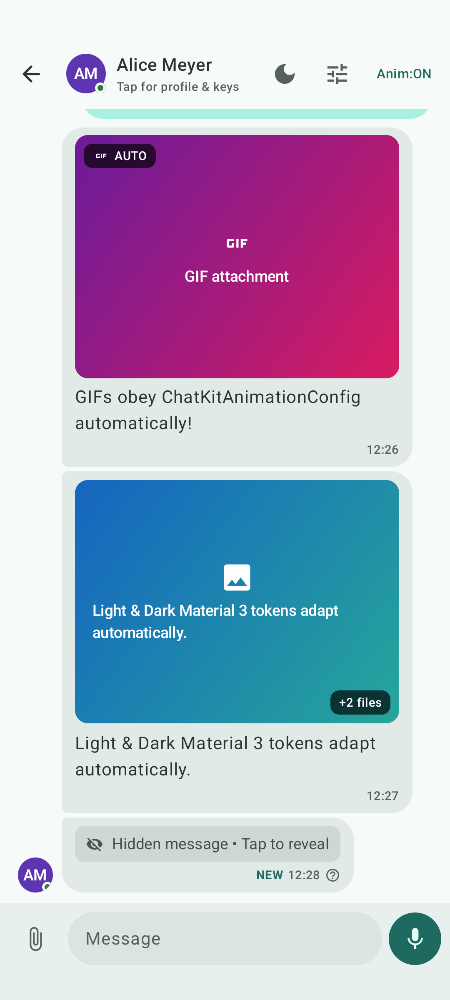
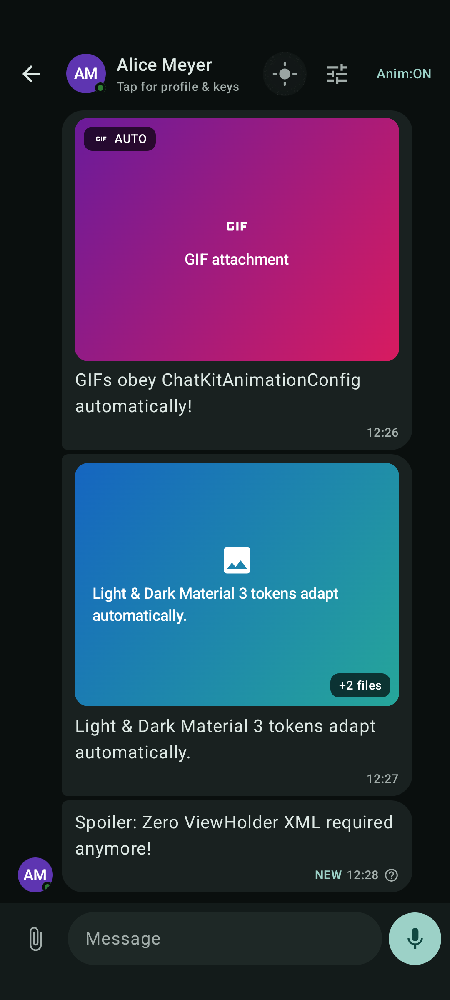
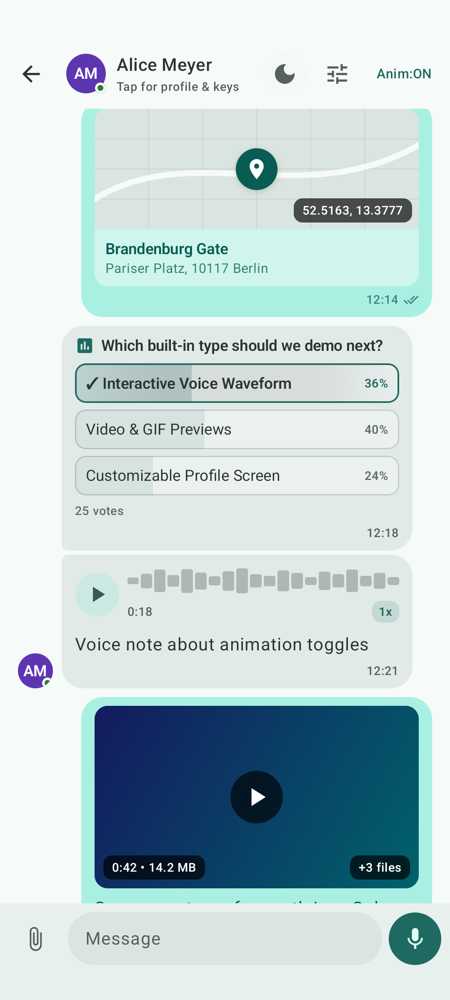
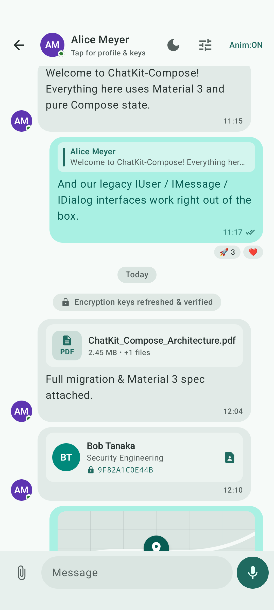
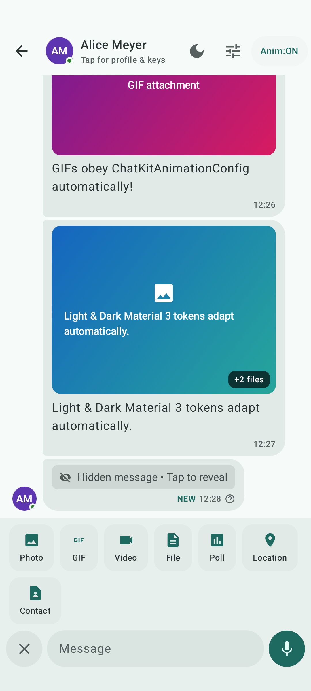
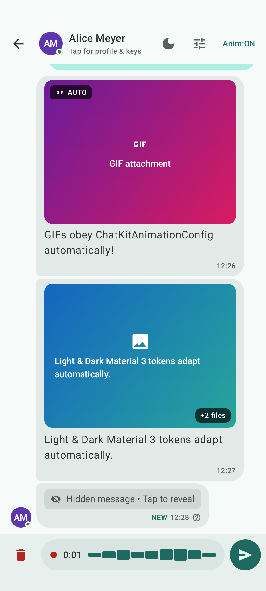
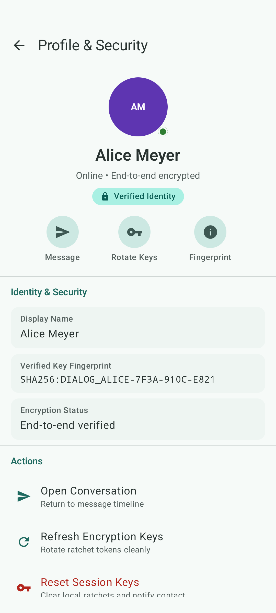

# ChatKit-Compose

A modern, **100% clean-room Jetpack Compose** and **Material 3** chat UI library inspired by and succeeding [stfalcon-studio/ChatKit](https://github.com/stfalcon-studio/ChatKit).

> [!NOTE]
> **Independent Community Project & Deep Gratitude**
> **ChatKit-Compose** is an independent, community-built Jetpack Compose successor—not an official Stfalcon product. We owe huge thanks to [Stfalcon](https://github.com/stfalcon-studio/ChatKit) for designing one of the cleanest, most model-agnostic chat UI libraries in Android history. Our goal is to help every developer move forward with Jetpack Compose and Material 3 effortlessly, **without throwing away existing data models or doing heavy rewrites**.

---

## Live Screenshots (Light, Dark, Rich Media & Profile)

All screenshots below are generated automatically from live Compose UI instrumentation tests ([`ChatKitShowcaseInstrumentationTest.kt`](./sample/src/androidTest/java/de/hartz/software/chatkitcompose/sample/ChatKitShowcaseInstrumentationTest.kt)) running on an Android device:

| Dialogs (Light) | Dialogs (Dark) | Chat Thread (Light) | Chat Thread (Dark) |
| :---: | :---: | :---: | :---: |
|  |  |  |  |

| Map, Poll, Voice & Video | Document, Contact & Security | Attachment Picker Tray | Voice Recording & Profile |
| :---: | :---: | :---: | :---: |
|  |  |  |   |

---

## Why ChatKit-Compose?

- **Zero Data-Layer Rewrite:** Keep your existing `IUser`, `IMessage`, `IDialog`, and `MessageContentType` implementations.
- **Effortless Adapter Migration:** Prefer incremental migration? Use `rememberMessagesListState` and `rememberDialogsListState` with familiar methods (`addToStart`, `addToEnd`, `update`, `deleteById`, `unselectAllItems`, `updateDialogWithMessage`, `scrollToMessageId`, `getMessageTimelineIndex`).
- **Pure Jetpack Compose Idioms:** Every component (`MessagesList`, `DialogsList`, `MessageInput`, `ChatProfileSection`) exposes strict state hoisting and standard `Modifier` conventions.
- **Material 3 Out of the Box:** Automatic Light/Dark theme and dynamic color support via `ChatKitDefaults`.
- **Complete Built-in Rich Message Types:**
  - **Images** (`MessageContentType.Image` / `ChatMessage` with `+N files` badge & missing-media handling)
  - **GIFs** (`MessageContentType.Gif` / `GifMessage` with `AUTO` / `STATIC` animation badge)
  - **Videos** (`MessageContentType.Video` / `VideoMessage` with play overlay, duration, file size, `+N files`)
  - **Voice Messages** (`MessageContentType.Voice` / `VoiceMessage` with interactive waveform scrubber & `1x/1.5x/2x` playback speed)
  - **Polls & Surveys** (`MessageContentType.Poll` / `PollMessage` with animated vote bars & percentage breakdown)
  - **Locations & Maps** (`MessageContentType.Location` / `LocationMessage` with stylized map canvas, pin & coordinates)
  - **Contacts** (`MessageContentType.Contact` / `ContactMessage` with avatar, organization/phone/email & key fingerprint)
  - **Documents & Files** (`MessageContentType.Document` / `DocumentMessage` + `ChatFileTypeDetector`)
  - **System & Security Events** (`MessageContentType.SystemEvent` / `SystemEventMessage`)
  - **Custom Types:** Pluggable `CustomContentConfig.Builder` Kotlin DSL replacing XML `ViewHolder` boilerplate.
- **Granular Animation & Feature Control:**
  - Toggle individual animations or disable all animations globally via `ChatKitAnimationConfig.Disabled`.
  - Enable/disable message types, replies, reactions, multi-selection, spoiler/privacy masking (`isMasked`), and message chunk counters (`maxMessageChunkSize`) via `ChatKitFeatureConfig`.
- **Built-in Attachment Picker, Voice Recorder & Profile Screen:**
  - `rememberChatAttachmentLaunchers` wraps Android Photo Picker & SAF multi-document selection.
  - `VoiceRecorderState` drives an interactive live-waveform recording bar inside `MessageInput`.
  - `ChatProfileSection` renders customizable user/group info, verification chips, quick actions, and member lists.

---

## Installation (JitPack)

Add the JitPack repository in `settings.gradle.kts`:

```kotlin
dependencyResolutionManagement {
    repositories {
        google()
        mavenCentral()
        maven { url = uri("https://jitpack.io") }
    }
}
```

Add the dependency in your module's `build.gradle.kts`:

```kotlin
dependencies {
    implementation("com.github.Hatzen:ChatKit-Compose:1.0.0")
}
```

---

## Quick Start

### 1. Plug In Your Own Data Models (or Use Built-in Immutable Models)

```kotlin
val currentUser = ChatUser(id = "me", name = "Kai", isOnline = true)
val peer = ChatUser(id = "alice", name = "Alice", isOnline = true)

val messagesState = rememberMessagesListState(
    senderId = currentUser.id,
    initialMessages = listOf(
        ChatMessage(
            id = "1",
            text = "Welcome to ChatKit-Compose!",
            user = peer,
            createdAt = Date(),
        ),
    ),
)
```

### 2. Configure Animations & Features Globally (Optional)

```kotlin
ProvideChatKitAnimationConfig(
    if (animationsEnabled) ChatKitAnimationConfig.Default else ChatKitAnimationConfig.Disabled
) {
    ProvideChatKitFeatureConfig(
        ChatKitFeatureConfig(
            enablePolls = true,
            enableLocations = true,
            enableVoiceMessages = true,
            maxMessageChunkSize = 140,
        )
    ) {
        ChatScreen()
    }
}
```

### 3. Render `MessagesList` + `MessageInput` (with Attachments & Voice Recording)

```kotlin
Scaffold(
    bottomBar = {
        MessageInput(
            onSendMessage = { text ->
                messagesState.addToStart(
                    ChatMessage(
                        id = UUID.randomUUID().toString(),
                        text = text,
                        user = currentUser,
                        createdAt = Date(),
                    ),
                    scroll = true,
                )
                true
            },
            onAttachmentOptionSelected = { kind -> /* handle Image, Gif, Video, File, Poll, Location, Contact */ },
            onVoiceMessageRecorded = { durationSeconds, waveform ->
                messagesState.addToStart(
                    VoiceMessage(
                        id = UUID.randomUUID().toString(),
                        audioUrl = "local://voice.opus",
                        durationSeconds = durationSeconds,
                        waveform = waveform,
                        user = currentUser,
                    ),
                )
            },
        )
    },
) { innerPadding ->
    MessagesList(
        state = messagesState,
        onSelectionChanged = { selectedCount -> /* toggle contextual TopAppBar */ },
        onAvatarClick = { user -> openProfile(user) },
        onPollVote = { pollMessage, optionId -> /* update poll state */ },
        onLoadMore = { page, totalItemsCount -> /* append older history */ },
        modifier = Modifier
            .fillMaxSize()
            .padding(innerPadding),
    )
}
```

### 4. Render `DialogsList` & `ChatProfileSection`

```kotlin
DialogsList(
    dialogs = dialogs,
    onDialogClick = { dialog -> openThread(dialog.id) },
    onDialogLongClick = { dialog -> showDialogOptions(dialog) },
)

ChatProfileSection(
    title = peer.name,
    avatarUrl = peer.avatar,
    subtitle = "Online • End-to-end encrypted",
    isOnline = peer.isOnline,
    verificationBadge = "Verified Identity",
    quickActions = listOf(
        ChatProfileQuickAction("msg", "Message", ChatKitIcons.Send) { openChat() },
        ChatProfileQuickAction("keys", "Rotate Keys", ChatKitIcons.Key) { refreshKeys() },
    ),
    items = listOf(
        ChatProfileItem.SectionHeader("Security"),
        ChatProfileItem.StaticInfo("Fingerprint", "SHA256:9F82-A1C0", isMonospace = true),
        ChatProfileItem.Action("Reset Session Keys", isDestructive = true) { resetKeys() },
    ),
)
```

---

## Documentation, Migration & Issue Audits

- 👉 **[Side-by-Side Migration Guide (`MIGRATION.md`)](./MIGRATION.md)** — XML + Adapter vs Compose equivalents.
- 🔍 **[Curated `stfalcon-studio/ChatKit` GitHub Issues Audit (`docs/STFALCON_ISSUES_ANALYSIS.md`)](./docs/STFALCON_ISSUES_ANALYSIS.md)** — 18 high-value community issues resolved natively.
- 🛠️ **[ParAnnoying Messenger Audit & Notes (`docs/PARANNOYING_MIGRATION_NOTES.md`)](./docs/PARANNOYING_MIGRATION_NOTES.md)** — Real-world workarounds removed in `ChatKit-Compose`.

---

## Development, Code Style & Agentic Harness

- [`AGENTS.md`](./AGENTS.md) — Architecture, Compose API guidelines, and Git workflow rules.
- [`.agents/rules/`](./.agents/rules/) — Contextual coding and Git rules.
- [`.agents/skills/`](./.agents/skills/) — Reusable `verify-build` and `migrate-chatkit` workflows.
- [`.editorconfig`](./.editorconfig) & [`config/detekt/detekt.yml`](./config/detekt/detekt.yml) — Kotlin & Compose static analysis rules.

Run unit tests, instrumentation tests, and debug builds locally:

```powershell
.\gradlew.bat testDebugUnitTest assembleDebug
.\gradlew.bat :sample:connectedDebugAndroidTest
```

---

## License

Licensed under the **Apache License, Version 2.0**. See [`LICENSE`](./LICENSE) and [`NOTICE`](./NOTICE) for full details and attribution to `stfalcon-studio/ChatKit`.
